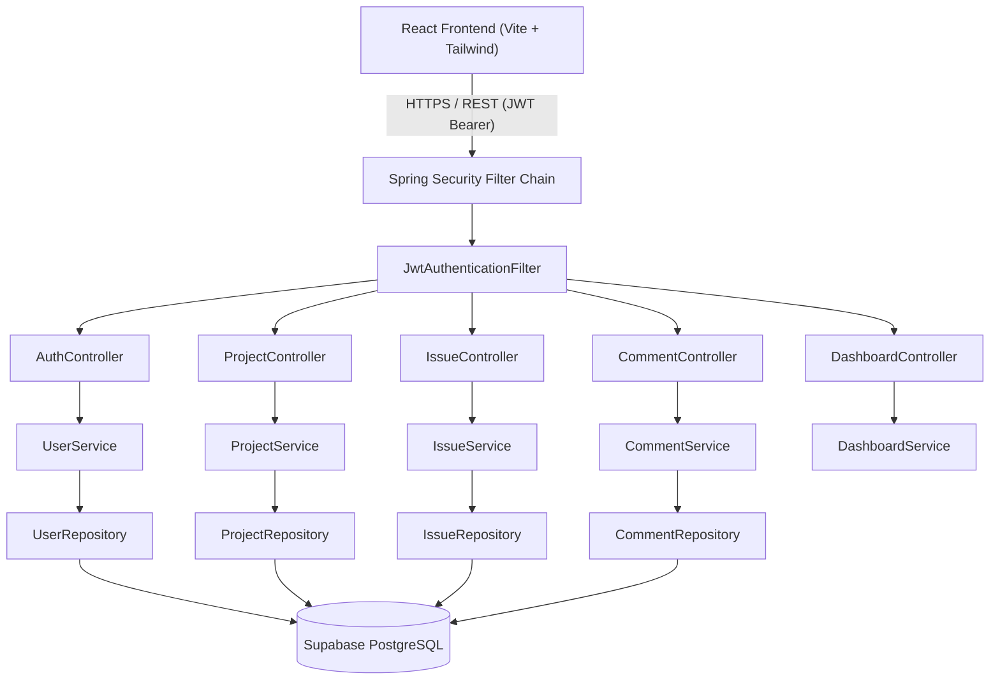
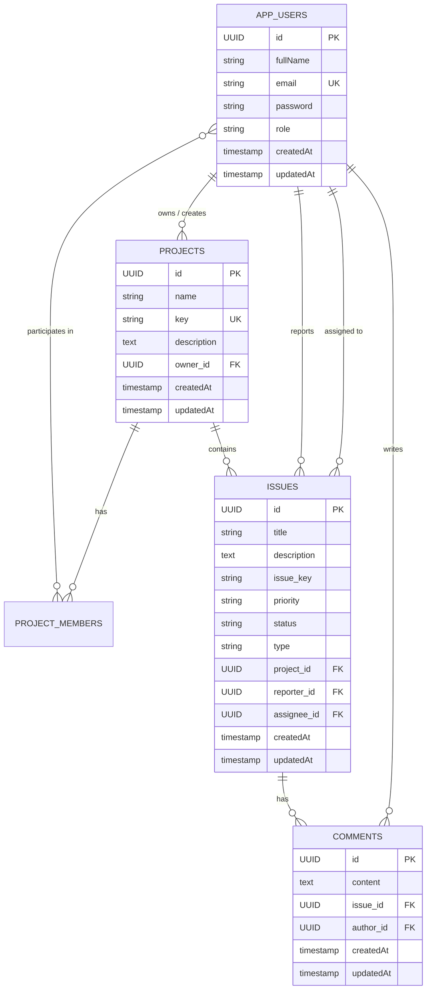

# 🚀 Bug Tracker / Issue Tracking System (Jira-Like SaaS Platform)

An enterprise-grade, full-stack **Bug & Issue Tracking System** built with **Java 21, Spring Boot, Spring Security (JWT), PostgreSQL (Supabase), and React (Vite + Tailwind CSS)**.

Designed with clean layered architecture, Role-Based Access Control (RBAC), and interactive drag-and-drop Kanban workflow.

---

## 🛠️ Technology Stack

### Backend
- **Java 21+**
- **Spring Boot 4.1.2**
- **Spring Data JPA & Hibernate**
- **Spring Security** with Stateless Session Management
- **JWT (JSON Web Token)** authentication via modern JJWT 0.12.6
- **PostgreSQL** (Supabase Cloud Database)
- **Bean Validation** (`jakarta.validation`)
- **Swagger / OpenAPI** for live API exploration
- **Maven** wrapper (`mvnw`)

### Frontend
- **React.js** (Vite template)
- **Tailwind CSS v4**
- **React Router v7** for single-page routing & protected paths
- **Axios** with automatic Bearer token interceptor and 401 handling
- **Lucide React** for clean SaaS iconography
- **Interactive Kanban Drag-and-Drop** workflow

---

## 🏛️ System Architecture



---

## 🗄️ Database Schema & Entity Relationships



---

## 📋 Features Overview

1. **Authentication & Authorization:**
   - Registration with automatic password encryption via `BCryptPasswordEncoder`.
   - Login returning a signed JWT containing user claims and role.
   - Protected routes in both backend (Spring Security) and frontend (`ProtectedRoute`).
   - Role-Based Access Control: `ADMIN`, `MANAGER`, `DEVELOPER`.

2. **Project Management:**
   - Create projects with custom unique keys (e.g., `PROJ`, `BUG`).
   - Add/remove team members by email address.
   - Project lead & member permission boundaries.

3. **Issue Tracking:**
   - Create bugs, tasks, and stories linked to projects with sequential keys (`BUG-1`, `BUG-2`).
   - Prioritize issues: `LOW`, `MEDIUM`, `HIGH`, `CRITICAL`.
   - Lifecycle statuses: `TO_DO`, `IN_PROGRESS`, `IN_REVIEW`, `DONE`.
   - Assign issues to project team members.

4. **Interactive Kanban Board:**
   - Visual 4-column workflow with drag-and-drop status transitions.
   - Real-time optimistic UI update with backend synchronization.
   - Fast modal view for comments, editing status, and reassignment.

5. **Collaboration & Comments:**
   - Live comments thread on every issue.
   - Author-protected delete actions.

6. **Dashboard & Analytics:**
   - Summary statistics: Total projects, open issues, in-progress, completed, and tickets assigned to the current user.
   - Interactive progress bar showing team completion percentages.
   - Recent activity list with one-click issue inspection.

---

## ⚡ Quick Start Guide

### 1. Prerequisites
- **Java 21+**
- **Node.js 20+** and **npm**
- **Supabase PostgreSQL** instance

---

### 2. Backend Setup
1. Open terminal in the `backend/` directory:
   ```powershell
   cd backend
   ```
2. Set your Supabase PostgreSQL credentials as environment variables:
   ```powershell
   $env:SUPABASE_DB_URL="jdbc:postgresql://<YOUR_SUPABASE_HOST>:5432/postgres?sslmode=require"
   $env:SUPABASE_DB_USERNAME="postgres"
   $env:SUPABASE_DB_PASSWORD="<YOUR_SUPABASE_PASSWORD>"
   ```
3. Run the Spring Boot backend:
   ```powershell
   .\mvnw.cmd spring-boot:run
   ```
4. Live API Documentation (Swagger):
   - **URL:** [http://localhost:8080/swagger-ui/index.html](http://localhost:8080/swagger-ui/index.html)
5. Health Check:
   - **URL:** [http://localhost:8080/api/health](http://localhost:8080/api/health)

---

### 3. Frontend Setup
1. In a separate terminal, open the `frontend/` directory:
   ```powershell
   cd frontend
   npm install
   ```
2. Start the Vite development server:
   ```powershell
   npm run dev
   ```
3. Open your browser and navigate to:
   - **App URL:** [http://localhost:5173](http://localhost:5173)

---

## 📡 REST API Reference Summary

### Authentication (`/api/auth`)
| Method | Endpoint | Access | Description |
|---|---|---|---|
| `POST` | `/api/auth/register` | Public | Register new user account (Default role: DEVELOPER) |
| `POST` | `/api/auth/login` | Public | Authenticate user & receive JWT Bearer token |
| `GET` | `/api/auth/me` | Protected | Get profile of currently logged-in user |

### Projects (`/api/projects`)
| Method | Endpoint | Access | Description |
|---|---|---|---|
| `POST` | `/api/projects` | Protected | Create a new project |
| `GET` | `/api/projects` | Protected | List all projects accessible by current user |
| `GET` | `/api/projects/{id}` | Protected | Get project details by UUID |
| `PUT` | `/api/projects/{id}` | Owner/Manager | Update project name and description |
| `DELETE` | `/api/projects/{id}` | Owner/Admin | Delete project and cascade its issues |
| `POST` | `/api/projects/{id}/members` | Owner/Manager | Add team member by email |
| `DELETE` | `/api/projects/{id}/members/{userId}` | Owner/Manager | Remove member from project |

### Issues (`/api/issues`)
| Method | Endpoint | Access | Description |
|---|---|---|---|
| `POST` | `/api/issues` | Protected | Create issue with priority and assignee |
| `GET` | `/api/issues` | Protected | Filter issues with pagination, search, status, priority |
| `GET` | `/api/issues/project/{projectId}` | Protected | Fetch all issues for Kanban view |
| `GET` | `/api/issues/{id}` | Protected | Get issue details by ID |
| `PUT` | `/api/issues/{id}` | Protected | Update issue fields |
| `PATCH` | `/api/issues/{id}/status` | Protected | Update status (`TO_DO`, `IN_PROGRESS`, `IN_REVIEW`, `DONE`) |
| `PATCH` | `/api/issues/{id}/assign` | Protected | Reassign issue |
| `DELETE` | `/api/issues/{id}` | Reporter/Owner | Delete issue |

### Comments (`/api/issues/{issueId}/comments`)
| Method | Endpoint | Access | Description |
|---|---|---|---|
| `POST` | `/api/issues/{issueId}/comments` | Protected | Post comment on issue |
| `GET` | `/api/issues/{issueId}/comments` | Protected | Fetch all comments on issue |
| `DELETE` | `/api/comments/{commentId}` | Author/Admin | Delete comment |

### Dashboard (`/api/dashboard`)
| Method | Endpoint | Access | Description |
|---|---|---|---|
| `GET` | `/api/dashboard/summary` | Protected | System metrics, counts, and recent issues |
| `GET` | `/api/dashboard/projects/{projectId}` | Protected | Project specific status counts |

---

## 🚢 Deployment Guide

### Backend on Render:
1. Push your repository to GitHub.
2. In [Render Dashboard](https://dashboard.render.com), create a **New Web Service** pointing to your repository.
3. Choose **Docker** as the environment (it uses `backend/Dockerfile`).
4. Set Root Directory to `backend`.
5. Add Environment Variables:
   - `SUPABASE_DB_URL`: Your Supabase connection string.
   - `SUPABASE_DB_USERNAME`: Database user.
   - `SUPABASE_DB_PASSWORD`: Database password.
   - `JWT_SECRET`: A 256-bit secret string for token signing.
   - `PORT`: `8080`

### Frontend on Vercel:
1. In [Vercel](https://vercel.com), import your GitHub repository.
2. Set Root Directory to `frontend`.
3. Build Command: `npm run build`
4. Output Directory: `dist`
5. The included [frontend/vercel.json](file:///c:/Users/barat/OneDrive/Desktop/Bug%20Tracker/frontend/vercel.json) handles single-page app (SPA) routing automatically.

